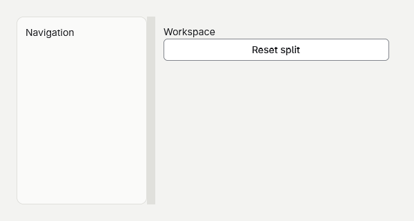

# A resizable panel



## 1. Create the project
Start after [Your first app](your-first-app.md) and run goo dev after replacing Program.gs.

```sh
dotnet new goo -n AResizablePanel
cd AResizablePanel
dotnet add package Goo.Widgets --version 0.19.6
```

## 2. Control the split ratio
The mounted splitter calls its parent, so update state and call Rebuild.

```gsharp
package Tutorial

import Goo
import Goo.Widgets
import Goo.Widgets.Actions
import Goo.Widgets.Layout

class Example : Cell {
    private var ratio float64 = .35

    override func Build() Blob {
        let theme = Theme.Read()
        return Container{
            BasedOn: theme.CanvasStyle,
            Width: Percent(100),
            Height: Percent(100),
            Padding: theme.Spacing * 6,
            Gap: theme.Spacing * 3,
            Cell.Mount[SplitPaneInput, SplitPane](
                "panes",
                SplitPaneInput{
                    Value: ratio,
                    MinimumFirst: theme.ControlHeight * 3,
                    MinimumSecond: theme.ControlHeight * 3,
                    First: Text{Content: "Navigation"},
                    Second: Text{Content: "Workspace"},
                    OnChange: (value float64) -> {
                        ratio = value
                        Rebuild()
                    },
                }
            ),
        }
    }
}

func Main() {
    Window.ConfigureApplication("A resizable panel", "1.0.0", "com.example.tutorial")
    let window = Window{Title: "A resizable panel", Width: 600, Height: 320, Root: Example{}}
    Theme.Attach(window, Theme.Default)
    window.Run()
}
```

## 3. Add pane content
Drag the divider or focus it and use the arrow keys.

```gsharp
package Tutorial

import Goo
import Goo.Widgets
import Goo.Widgets.Actions
import Goo.Widgets.Layout

class Example : Cell {
    private var ratio float64 = .35

    override func Build() Blob {
        let theme = Theme.Read()
        return Container{
            BasedOn: theme.CanvasStyle,
            Width: Percent(100),
            Height: Percent(100),
            Padding: theme.Spacing * 6,
            Gap: theme.Spacing * 3,
            Cell.Mount[SplitPaneInput, SplitPane](
                "panes",
                SplitPaneInput{
                    Value: ratio,
                    MinimumFirst: theme.ControlHeight * 3,
                    MinimumSecond: theme.ControlHeight * 3,
                    First: Container{
                        BasedOn: theme.PanelStyle,
                        Width: Percent(100),
                        Height: Percent(100),
                        Padding: theme.Spacing * 3,
                        Text{Content: "Navigation"},
                    },
                    Second: Container{
                        Width: Percent(100),
                        Height: Percent(100),
                        Padding: theme.Spacing * 3,
                        Text{Content: "Workspace"},
                        ActionButton{
                            Content: "Reset split",
                            OnClick: () -> {
                                ratio = .35
                                Rebuild()
                            },
                        }.Build(),
                    },
                    OnChange: (value float64) -> {
                        ratio = value
                        Rebuild()
                    },
                }
            ),
        }
    }
}

func Main() {
    Window.ConfigureApplication("A resizable panel", "1.0.0", "com.example.tutorial")
    let window = Window{Title: "A resizable panel", Width: 600, Height: 320, Root: Example{}}
    Theme.Attach(window, Theme.Default)
    window.Run()
}
```
