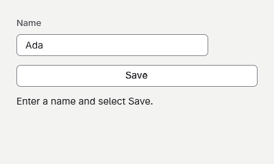

# A text input form



## 1. Create the project
Start after [Your first app](your-first-app.md) and run goo dev after replacing Program.gs.

```sh
dotnet new goo -n ATextInputForm
cd ATextInputForm
dotnet add package Goo.Widgets --version 0.19.6
```

## 2. Keep the field value
TextField supplies editing keys and Tab focus, while its callbacks explicitly rebuild the parent.

```gsharp
package Tutorial

import Goo
import Goo.Widgets
import Goo.Widgets.Actions
import Goo.Widgets.Inputs

class Example : Cell {
    private var name string = "Ada"

    override func Build() Blob {
        let theme = Theme.Read()
        return Container{
            BasedOn: theme.CanvasStyle,
            Width: Percent(100),
            Height: Percent(100),
            Padding: theme.Spacing * 6,
            Gap: theme.Spacing * 3,
            TextField{
                Label: "Name",
                Value: name,
                OnChange: (value string) -> {
                    name = value
                    Rebuild()
                },
            }.Build(),
            Text{Content: "Hello, $name"},
        }
    }
}

func Main() {
    Window.ConfigureApplication("A text input form", "1.0.0", "com.example.tutorial")
    let window = Window{Title: "A text input form", Width: 400, Height: 200, Root: Example{}}
    Theme.Attach(window, Theme.Default)
    window.Run()
}
```

## 3. Submit the form
Select Save or press Enter in the field.

```gsharp
package Tutorial

import Goo
import Goo.Widgets
import Goo.Widgets.Actions
import Goo.Widgets.Inputs

class Example : Cell {
    private var name string = "Ada"
    private var greeting string = "Enter a name and select Save."

    override func Build() Blob {
        let theme = Theme.Read()
        return Container{
            BasedOn: theme.CanvasStyle,
            Width: Percent(100),
            Height: Percent(100),
            Padding: theme.Spacing * 6,
            Gap: theme.Spacing * 3,
            TextField{
                Label: "Name",
                Value: name,
                OnChange: (value string) -> {
                    name = value
                    Rebuild()
                },
                OnSubmit: (value string) -> {
                    greeting = "Hello, $value"
                    Rebuild()
                },
            }.Build(),
            ActionButton{Content: "Save", OnClick: () -> { greeting = "Hello, $name" }}.Build(),
            Text{Content: greeting},
        }
    }
}

func Main() {
    Window.ConfigureApplication("A text input form", "1.0.0", "com.example.tutorial")
    let window = Window{Title: "A text input form", Width: 400, Height: 240, Root: Example{}}
    Theme.Attach(window, Theme.Default)
    window.Run()
}
```
