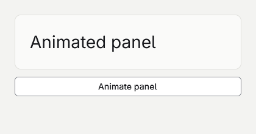

# Animating a panel



## 1. Create the project
Start after [Your first app](your-first-app.md) and run goo dev after replacing Program.gs.

```sh
dotnet new goo -n AnimatingAPanel
cd AnimatingAPanel
dotnet add package Goo.Widgets --version 0.20.0
```

## 2. Animate opacity
AnimateValue changes paint without rebuilding each frame.

```gsharp
package Tutorial

import Goo
import Goo.Widgets
import Goo.Widgets.Actions

class Example : Cell {
    private let opacity Anim[float64]
    private var dimmed bool

    init() {
        opacity = AnimateValue(1.0)
    }

    override func Build() Blob {
        let theme = Theme.Read()
        return Container{
            BasedOn: theme.CanvasStyle,
            Width: Percent(100),
            Height: Percent(100),
            Padding: theme.Spacing * 6,
            Gap: theme.Spacing * 3,
            Container{
                BasedOn: theme.PanelStyle,
                Padding: theme.Spacing * 6,
                OpacityAnim: opacity,
                Text{Content: "Animated panel", FontSize: theme.H2FontSize},
            },
            ActionButton{
                Content: "Fade panel",
                OnClick: () -> {
                    dimmed = !dimmed
                    opacity.To(if dimmed { .25 } else { 1.0 }, Motion.Tween(theme.MotionNormalMs))
                },
            }.Build(),
        }
    }
}

func Main() {
    Window.ConfigureApplication("Animating a panel", "1.0.0", "com.example.tutorial")
    let window = Window{Title: "Animating a panel", Width: 420, Height: 220, Root: Example{}}
    Theme.Attach(window, Theme.Default)
    window.Run()
}
```

## 3. Add translation
Bind a second paint animation to move the panel.

```gsharp
package Tutorial

import Goo
import Goo.Widgets
import Goo.Widgets.Actions

class Example : Cell {
    private let opacity Anim[float64]
    private let translation Anim[Point]
    private var dimmed bool

    init() {
        opacity = AnimateValue(1.0)
        translation = AnimateValue(Point{})
    }

    override func Build() Blob {
        let theme = Theme.Read()
        return Container{
            BasedOn: theme.CanvasStyle,
            Width: Percent(100),
            Height: Percent(100),
            Padding: theme.Spacing * 6,
            Gap: theme.Spacing * 3,
            Container{
                BasedOn: theme.PanelStyle,
                Padding: theme.Spacing * 6,
                OpacityAnim: opacity,
                TranslateAnim: translation,
                Text{Content: "Animated panel", FontSize: theme.H2FontSize},
            },
            ActionButton{
                Content: "Animate panel",
                OnClick: () -> {
                    dimmed = !dimmed
                    translation.To(Point{X: if dimmed { theme.Spacing * 4 } else { 0.0 }}, Motion.Tween(theme.MotionNormalMs))
                    opacity.To(if dimmed { .25 } else { 1.0 }, Motion.Tween(theme.MotionNormalMs))
                },
            }.Build(),
        }
    }
}

func Main() {
    Window.ConfigureApplication("Animating a panel", "1.0.0", "com.example.tutorial")
    let window = Window{Title: "Animating a panel", Width: 420, Height: 220, Root: Example{}}
    Theme.Attach(window, Theme.Default)
    window.Run()
}
```
