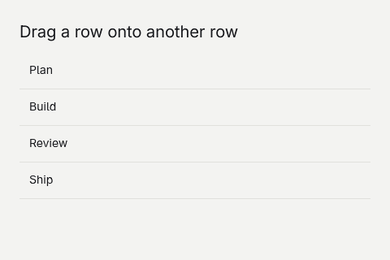

# Drag and drop a list



## 1. Create the project
Start after [Your first app](your-first-app.md) and run goo dev after replacing Program.gs.

```sh
dotnet new goo -n DragAndDropAList
cd DragAndDropAList
dotnet add package Goo.Widgets --version 0.19.6
```

## 2. Reorder rows
Drop a row onto another row to move it before that row.

```gsharp
package Tutorial

import Goo
import Goo.Widgets
import Goo.Widgets.Actions
import Goo.Widgets.Data
import System
import System.Collections.Generic

class Example : Cell {
    private var items []string = []string{"Plan", "Build", "Review", "Ship"}
    private let buildRow Func[string, Blob]

    init() {
        buildRow = BuildRow
    }

    override func Build() Blob {
        let theme = Theme.Read()
        let list = VirtualRows[string](items, theme.ControlHeight * 2, ItemKey, buildRow)
        list.FlexGrow = 1
        list.MinHeight = 0
        return Container{
            BasedOn: theme.CanvasStyle,
            Width: Percent(100),
            Height: Percent(100),
            Padding: theme.Spacing * 6,
            Gap: theme.Spacing * 3,
            Text{Content: "Drag a row onto another row", FontSize: theme.HeadingFontSize},
            list,
        }
    }
    private func ItemKey(item string) string -> item

    private func BuildRow(item string) Blob {
        let theme = Theme.Read()
        return Container{
            Key: item,
            Padding: theme.Spacing * 3,
            BorderWidth: Edges{Bottom: theme.BorderWidth},
            BorderColor: theme.BorderColor,
            DragSource: DragSource((_ DragStartEvent) -> DragData(item, DragEffect.Move)),
            DropTarget: DropTarget(
                (event DragEvent) -> if event.Data.Value is string { DragEffect.Move } else { DragEffect.None },
                (event DragEvent) -> {
                    if event.Kind == DragEventKind.Drop && event.Data.Value is string source && source != item {
                        let next = List[string](items)
                        next.Remove(source)
                        next.Insert(next.IndexOf(item), source)
                        items = next.ToArray()
                        Rebuild()
                    }
                }
            ),
            Text{Content: item},
        }
    }
}

func Main() {
    Window.ConfigureApplication("Drag and drop a list", "1.0.0", "com.example.tutorial")
    let window = Window{Title: "Drag and drop a list", Width: 480, Height: 320, Root: Example{}}
    Theme.Attach(window, Theme.Default)
    window.Run()
}
```
