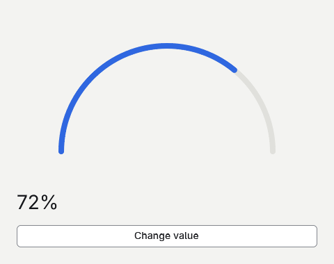

# Drawing a gauge



Start with the [tutorial setup](../README.md#tutorial-setup). Replace `Program.gs`, then run `goo dev`.

## Trim a curved stroke
Reuse one path for the track and the value.

```gsharp
package Tutorial

import Goo
import Goo.Widgets
import Goo.Widgets.Actions

class Example : Cell {
    private let arc VectorPath = PathBuilder(0, 0, 200, 120)
        .MoveTo(20, 100).ArcTo(80, 80, 0, false, true, 180, 100).Build()
    private var value float64 = .72

    override func Build() Blob {
        let theme = Theme.Read()
        return Column{
            BasedOn: theme.CanvasStyle,
            Width: Percent(100),
            Height: Percent(100),
            Padding: theme.Spacing * 6,
            Gap: theme.Spacing * 3,
            Container{
                FlexGrow: 1,
                Stroke(theme, theme.BorderColor, 1.0),
                Stroke(theme, theme.AccentColor, value),
            },
            Text{Content: "${int32(value * 100)}%", FontSize: theme.H2FontSize},
            ActionButton{
                Content: "Change value",
                OnClick: () -> { value = if value > .5 { .35 } else { .72 } },
            },
        }
    }

    private func Stroke(theme Theme, color Color, end float64) Shape -> Shape{
        Path: arc,
        Width: Percent(100),
        Height: Percent(100),
        Position: PositionType.Absolute,
        Stroke: VectorStroke(theme.Spacing * 2, color){Cap = StrokeCap.Round},
        StrokeEnd: end,
    }
}

func Main() {
    Application.Configure("Drawing a gauge", "1.0.0", "com.example.tutorial")
    let window = Window{Title: "Drawing a gauge", Size: LayoutSize(480, 380), Root: Example{}}
    Theme.Attach(window, Theme.Default)
    Application.Run(window)
}
```
