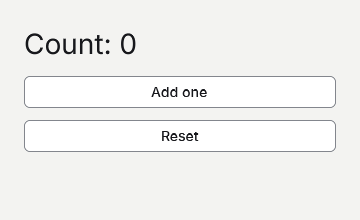

# Managing state



## 1. Create the project
Start after [Your first app](your-first-app.md) and run goo dev after replacing Program.gs.

```sh
dotnet new goo -n ManagingState
cd ManagingState
dotnet add package Goo.Widgets --version 0.19.6
```

## 2. Store state in a Cell
Goo rebuilds this Cell after its input callbacks.

```gsharp
package Tutorial

import Goo
import Goo.Widgets
import Goo.Widgets.Actions

class Example : Cell {
    private var count int32

    override func Build() Blob {
        let theme = Theme.Read()
        return Container{
            BasedOn: theme.CanvasStyle,
            Width: Percent(100),
            Height: Percent(100),
            Padding: theme.Spacing * 6,
            Gap: theme.Spacing * 3,
            Text{Content: "Count: $count", FontSize: theme.H2FontSize},
            ActionButton{Content: "Add one", OnClick: () -> { count++ }}.Build(),
        }
    }
}

func Main() {
    Window.ConfigureApplication("Managing state", "1.0.0", "com.example.tutorial")
    let window = Window{Title: "Managing state", Width: 360, Height: 200, Root: Example{}}
    Theme.Attach(window, Theme.Default)
    window.Run()
}
```

## 3. Add a reset action
Both buttons update the same retained state.

```gsharp
package Tutorial

import Goo
import Goo.Widgets
import Goo.Widgets.Actions

class Example : Cell {
    private var count int32

    override func Build() Blob {
        let theme = Theme.Read()
        return Container{
            BasedOn: theme.CanvasStyle,
            Width: Percent(100),
            Height: Percent(100),
            Padding: theme.Spacing * 6,
            Gap: theme.Spacing * 3,
            Text{Content: "Count: $count", FontSize: theme.H2FontSize},
            ActionButton{Content: "Add one", OnClick: () -> { count++ }}.Build(),
            ActionButton{Content: "Reset", OnClick: () -> { count = 0 }}.Build(),
        }
    }
}

func Main() {
    Window.ConfigureApplication("Managing state", "1.0.0", "com.example.tutorial")
    let window = Window{Title: "Managing state", Width: 360, Height: 220, Root: Example{}}
    Theme.Attach(window, Theme.Default)
    window.Run()
}
```
