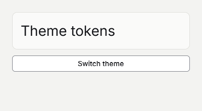

# Styling and themes



## 1. Create the project
Start after [Your first app](your-first-app.md) and run goo dev after replacing Program.gs.

```sh
dotnet new goo -n StylingAndThemes
cd StylingAndThemes
dotnet add package Goo.Widgets --version 0.20.0
```

## 2. Read theme tokens
Put BasedOn before local style overrides.

```gsharp
package Tutorial

import Goo
import Goo.Widgets
import Goo.Widgets.Actions

class Example : Cell {

    override func Build() Blob {
        let theme = Theme.Read()
        return Container{
            BasedOn: theme.CanvasStyle,
            Width: Percent(100),
            Height: Percent(100),
            Padding: theme.Spacing * 6,
            Gap: theme.Spacing * 3,
            Container{
                BasedOn: theme.PanelStyle,
                Padding: theme.Spacing * 4,
                Text{Content: "Theme tokens", FontSize: theme.H2FontSize},
            },
        }
    }
}

func Main() {
    Window.ConfigureApplication("Styling and themes", "1.0.0", "com.example.tutorial")
    let window = Window{Title: "Styling and themes", Width: 400, Height: 160, Root: Example{}}
    Theme.Attach(window, Theme.Default)
    window.Run()
}
```

## 3. Switch the window theme
Theme changes update subscribed controls.

```gsharp
package Tutorial

import Goo
import Goo.Widgets
import Goo.Widgets.Actions

class Example : Cell {

    private var dark bool
    private let window Window

    init(window Window) {
        this.window = window
    }

    override func Build() Blob {
        let theme = Theme.Read()
        return Container{
            BasedOn: theme.CanvasStyle,
            Width: Percent(100),
            Height: Percent(100),
            Padding: theme.Spacing * 6,
            Gap: theme.Spacing * 3,
            Container{
                BasedOn: theme.PanelStyle,
                Padding: theme.Spacing * 4,
                Text{Content: "Theme tokens", FontSize: theme.H2FontSize},
            },
            ActionButton{
                Content: "Switch theme",
                OnClick: () -> {
                    dark = !dark
                    Theme.SetMode(window, if dark { ThemeMode.Dark } else { ThemeMode.Light })
                },
            }.Build(),
        }
    }
}

func Main() {
    Window.ConfigureApplication("Styling and themes", "1.0.0", "com.example.tutorial")
    let window = Window{Title: "Styling and themes", Width: 400, Height: 220}
    window.Root = Example(window)
    Theme.Attach(window, Theme.Default)
    window.Run()
}
```
