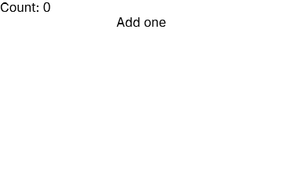

# Your first app: the README counter



## 1. Install
Use .NET 10.0.403 or later, Vulkan 1.3, and native Wayland on Linux.

```sh
dotnet new install Goo.Templates@0.29.0
dotnet tool install --global Goo.DevTools --version 0.29.0
```

## 2. Create and run
The template selects Goo 0.29.0 and G# SDK 0.5.212.

```sh
dotnet new goo -n HelloGoo
cd HelloGoo
goo dev
```

## 3. Replace Program.gs
This is the README counter, unchanged.

```gsharp
package GooStarter

import Goo

class Counter : Cell {
    private var count int32

    override func Build() Blob -> Container{
        Width: Percent(100),
        Text{Content: "Count: $count"},
        Button{
            OnClick: () -> { count++ },
            Text{Content: "Add one"},
        },
    }
}

func Main() {
    Window.ConfigureApplication("Goo starter", "1.0.0", "com.example.goostarter")
    Window{Title: "Goo starter", Width: 360, Height: 220, Root: Counter{}}.Run()
}
```
